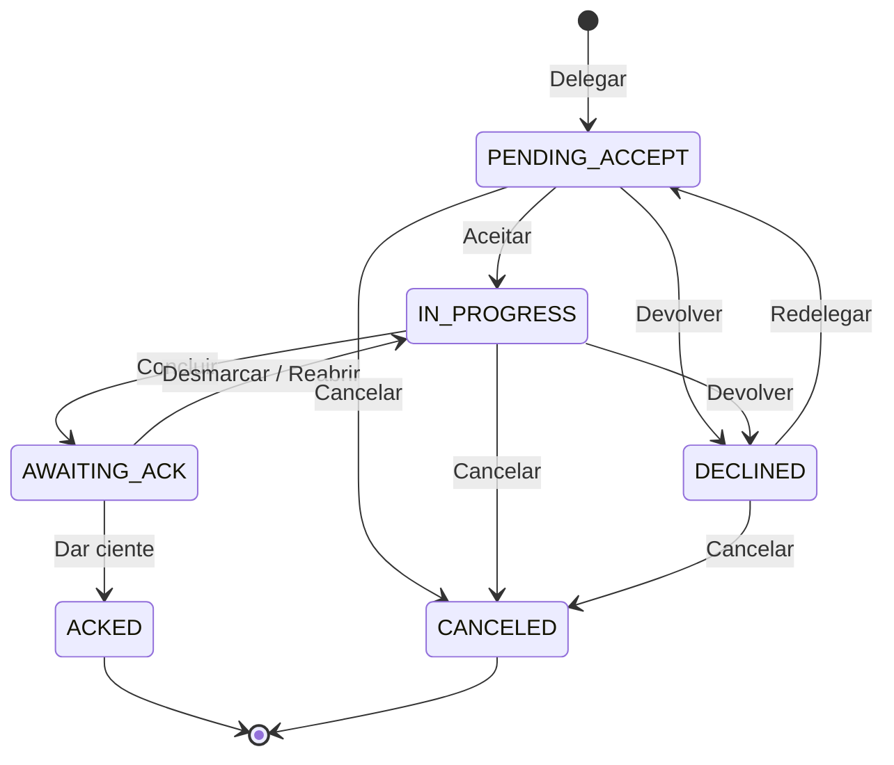

# SyncTasks: especificação funcional e técnica

> O aplicativo se chamava **Nerus Tasks** até a terceira rodada de ajustes (ver `docs/feedback.md`, itens 13 e 20).
>
> Esta especificação está atualizada até o **item 51** de `docs/feedback.md`. Ela também aparece dentro do app, na **Ajuda** › **Especificação**, para a administração; o guia do usuário fica em `docs/guia-do-usuario.md` e aparece na Ajuda para todos (seção 12.10).

| | |
|---|---|
| **Versão** | 1.1 (atualizada com as rodadas de ajuste até o item 51) |
| **Data** | 18/10/2026 (primeira versão: 04/10/2026) |
| **Status** | **Em produção** desde 16/10/2026 em https://synctasks.onrender.com (item 45), com o Cleber (CEO e administrador) e o Daniel (gestor). Histórico dos pedidos em `docs/feedback.md`; como rodar e publicar no README. |
| **Público** | ~90 a 99 pessoas da Nerus |
| **Protótipo navegável** | https://claude.ai/artifact/PzRKBmbgfbtbztuQDLnWcd |
| **Amostra do visual aprovado** | https://claude.ai/artifact/VS56Z1i99KfRCXToV47EHm |

---

## Sumário

1. [Contexto e objetivo](#1-contexto-e-objetivo)
2. [Escopo](#2-escopo)
3. [Glossário](#3-glossário)
4. [Papéis e hierarquia](#4-papéis-e-hierarquia)
5. [Visibilidade e permissões](#5-visibilidade-e-permissões)
6. [Jornadas](#6-jornadas)
7. [Regras de negócio](#7-regras-de-negócio)
8. [Código da tarefa](#8-código-da-tarefa)
9. [Ciclo de vida da delegação](#9-ciclo-de-vida-da-delegação)
10. [Log (histórico) da tarefa](#10-log-histórico-da-tarefa)
11. [Avisos e e-mails](#11-avisos-e-e-mails)
12. [Telas](#12-telas)
13. [Diretrizes de interface](#13-diretrizes-de-interface)
14. [Modelo de dados](#14-modelo-de-dados)
15. [API](#15-api)
16. [Requisitos não funcionais](#16-requisitos-não-funcionais)
17. [Arquitetura, hospedagem e custos](#17-arquitetura-hospedagem-e-custos)
18. [Plano de entrega](#18-plano-de-entrega)
19. [Critérios de aceite](#19-critérios-de-aceite)
20. [Questões que estavam em aberto](#20-questões-que-estavam-em-aberto)
    - [Painel e captura da web](#20a-painel-e-captura-da-web-terceira-rodada)
21. [Fora do escopo e evoluções futuras](#21-fora-do-escopo-e-evoluções-futuras)

---

## 1. Contexto e objetivo

A Nerus tem cerca de 90 pessoas organizadas em quatro níveis: **CEO > Diretores > Gestores > Funcionários**. Cada pessoa precisa organizar o próprio trabalho com liberdade, como no Trello. Os superiores precisam saber, sem esforço, o que delegaram e em que pé está.

**O problema que o produto resolve:**

> "Quais atividades deleguei para meus funcionários que ainda não foram concluídas? Posso mandar mais tarefas?"

**Objetivos da primeira versão:**

1. Cada pessoa organiza suas tarefas em quadros e fases livres.
2. O superior delega tarefas ao subordinado direto e acompanha o status até dar o ciente.
3. O superior vê, numa única tela, a situação de cada subordinado: abertas, atrasadas, aguardando ciente, devolvidas e volume de tarefas próprias.
4. Tudo o que acontece com uma tarefa fica registrado e pode ser consultado a qualquer momento.
5. Cada evento importante gera aviso no app e por e-mail.

---

## 2. Escopo

### 2.1 Dentro do escopo (v1)

- Cadastro de pessoas e da hierarquia, feito pelo administrador.
- Login com e-mail e senha. A senha é definida pelo link enviado por e-mail.
- Quadros pessoais com fases (listas) livres: criar, renomear, reordenar e arquivar (só quando vazias).
- Tarefas com título, descrição, prazo, checklist, comentários, privacidade e código único.
- Arrastar tarefas entre fases.
- Delegação ao subordinado direto, com caixa de entrada, devolução justificada, conclusão, ciente, reabertura, cancelamento e redelegação.
- Transferência de tarefa (diferente de delegar).
- Transferência de gestão, feita pelo administrador.
- Tela **Tarefas delegadas** para quem tem subordinados.
- Log completo e imutável de cada tarefa.
- Busca por texto e por código.
- Avisos no app e e-mails pelo Google Workspace.
- PWA instalável no celular. Tamanho do texto ajustável. Tema claro e escuro.

**Acrescentado nas rodadas de ajuste** (detalhes em `docs/feedback.md`):

- **Painel** para quem tem equipe, com as delegadas por pessoa (itens 17 e 27).
- **Tabela** com filtros por condições, filtros salvos e exportação para planilha (item 36); o mesmo filtro no quadro (item 47).
- **Arquivadas**: tarefas e quadros arquivados, com pesquisa e desarquivar (itens 35 e 42).
- **Captura da web** e de e-mails do Gmail para a caixa de entrada (itens 14 e 21).
- **Importar do Trello** e **Exportar para o Trello** (item 31).
- Número da tarefa por quadro (#12) e cor de um cartão só (itens 37, 38 e 40).
- Caixa de entrada com aceitar, delegar e descartar, inclusive várias de uma vez (item 50).
- E-mails de aceite, de prazo (véspera e vencido) e resumo diário (item 46).
- Cancelar a delegação de dentro da tarefa, com Desfazer (item 48); marca **Não pode ser repassada** (item 41).
- Desativar uma pessoa escolhendo quem recebe as pendências (item 44).
- Guia do usuário e especificação dentro da Ajuda (item 51).

### 2.2 Fora do escopo (v1)

Anexos e integração com o Google Drive, trabalho entre times, vários responsáveis por tarefa, quadros compartilhados, indicador de performance, registro de horas, etiquetas, @menções, data de início, modelos, calendário, automações e integrações. A seção 21 traz a lista completa.

---

## 3. Glossário

| Termo | Significado |
|---|---|
| **Quadro** | Espaço pessoal de organização. Cada pessoa cria quantos quiser. |
| **Fase (lista)** | Coluna de um quadro, como "A fazer" ou "Fazendo". Nomes e quantidade são livres. |
| **Tarefa (cartão)** | Item de trabalho. Pertence a uma única pessoa (o **detentor**). |
| **Tarefa própria** | Tarefa criada pela própria pessoa, sem delegação. |
| **Delegar** | O superior entrega uma tarefa ao **subordinado direto** e continua acompanhando até dar o ciente. |
| **Delegador** | Quem delegou. |
| **Cartão ligado** | Na delegação, o delegador mantém o próprio cartão e o subordinado recebe um cartão novo, ligado ao primeiro. |
| **Desdobramento** | O cartão recebido por delegação, visto em relação ao cartão de origem. |
| **Caixa de entrada** | Lugar onde chegam delegações e transferências antes de a pessoa colocá-las num quadro. |
| **Devolver** | O subordinado recusa a delegação, com justificativa obrigatória. |
| **Concluir** | Marcar a tarefa como feita. Independe da fase em que ela está. |
| **Ciente** | Validação do delegador sobre uma tarefa concluída. Arquiva a tarefa. |
| **Reabrir** | O delegador não aceita a conclusão e devolve a tarefa com comentário. |
| **Transferir** | Passar a tarefa a outra pessoa. Quem transfere deixa de acompanhar. |
| **Transferir gestão** | O administrador muda o superior direto de uma pessoa, pelo campo **Superior direto** em **Editar dados**. |
| **Log** | Registro imutável de tudo o que aconteceu com a tarefa. |

---

## 4. Papéis e hierarquia

### 4.1 Níveis

| Nível | Papel | Superior direto |
|---|---|---|
| 0 | CEO | nenhum |
| 1 | Diretor | CEO |
| 2 | Gestor | Diretor ou CEO |
| 3 | Funcionário | Gestor, Diretor ou CEO (item 32) |
| (fora da árvore) | Administrador | não se aplica |

- Cada pessoa tem **exatamente um** superior direto, exceto o CEO.
- O superior de uma pessoa está **num nível acima** dela. O **diretor** responde ao CEO; o **gestor** responde a um diretor ou **direto ao CEO** (item 29); o **funcionário** responde a um gestor, a um diretor ou **direto ao CEO** (item 32). Assim uma pessoa pode ser CEO, fazer o papel de diretor de uma área e ser administradora com uma conta só, sem criar níveis novos.
- A hierarquia é uma árvore de pessoas. Não existe o conceito de "time" como entidade.
- **Subordinados diretos** são as pessoas cujo superior direto é você.
- O **administrador** é um papel de sistema, fora da árvore. Ele não delega nem recebe tarefas. A mesma pessoa pode ter as duas coisas: um cargo na árvore e a permissão de administrador.

### 4.2 Administração da estrutura

Só o administrador:
- cadastra pessoas (nome, e-mail, cargo, superior direto);
- desativa pessoas, resolvendo as pendências delas numa vez só, e as reativa (seção 7.10, item 44);
- executa a **transferência de gestão** (seção 7.9).

---

## 5. Visibilidade e permissões

### 5.1 Princípios

1. **Os quadros são pessoais.** Ninguém além do dono vê os quadros e as fases de uma pessoa.
2. **O superior vê só as delegações que ele mesmo fez,** e apenas aos subordinados diretos.
3. **De cada subordinado, o superior vê só um número de tarefas próprias,** apenas para conhecimento. O conteúdo dessas tarefas nunca aparece.
4. **Tarefas privadas nunca aparecem para superiores.**
5. **Por enquanto, o log é visível só para administrador, CEO e diretores** (seção 10).
6. Toda regra é verificada no servidor. A interface apenas reflete o que a API permite.

### 5.2 Matriz

| Ação ou dado | Funcionário | Gestor | Diretor | CEO | Admin |
|---|:-:|:-:|:-:|:-:|:-:|
| Ver e editar os próprios quadros, fases e tarefas | ✔ | ✔ | ✔ | ✔ | — |
| Ver quadros de outra pessoa | ✘ | ✘ | ✘ | ✘ | ✘ |
| Delegar (ao subordinado direto) | ✘ | ✔ | ✔ | ✔ | — |
| Ver a tela Tarefas delegadas | ✘ | ✔ | ✔ | ✔ | — |
| Ver as tarefas que **ele** delegou | — | ✔ | ✔ | ✔ | — |
| Ver delegações feitas por outros (drill-down) | ✘ | ✘ | ✘ | ✘ | ✘ |
| Ver o contador de tarefas próprias de subordinado direto | — | ✔ | ✔ | ✔ | — |
| Ver o log de tarefas | ✘ | ✘ | ✔ * | ✔ * | ✔ * |
| Cadastrar pessoas e definir superior | ✘ | ✘ | ✘ | ✘ | ✔ |
| Transferir gestão | ✘ | ✘ | ✘ | ✘ | ✔ |

\* A abrangência ainda está em aberto: todas as tarefas ou só as da diretoria. Ver a seção 20.

---

## 6. Jornadas

### 6.1 Funcionário

1. Abre o app em **Tarefas** e organiza as tarefas nas fases que criou.
2. Vê um número na **Caixa de entrada** quando chega uma delegação.
3. Abre a caixa de entrada e, para cada item:
   - **aceita**, escolhendo em qual quadro e fase colocar; ou
   - **devolve**, com justificativa obrigatória.
4. Trabalha na tarefa: move entre fases, marca itens do checklist, comenta e ajusta o prazo se precisar. Ao mudar o prazo, o delegador recebe aviso.
5. Clica em **Concluir**. A tarefa fica "aguardando ciente" para o superior.
6. Recebe aviso quando o superior dá o ciente (a tarefa é arquivada) ou reabre (com o motivo).

### 6.2 Gestor (vale também para diretor e CEO)

1. Cria a tarefa no próprio quadro.
2. Abre a tarefa e usa **Delegar**: escolhe o subordinado direto, o prazo sugerido e, se quiser, uma observação.
3. Acompanha em **Tarefas delegadas**:
   - a seção **Precisam da sua ação** lista o que aguarda ciente e o que foi devolvido;
   - a seção **Equipe** traz uma linha por subordinado, com contadores (abertas, atrasadas, aguardando ciente, devolvidas, próprias) e a lista de tarefas delegadas a cada um.
4. Para tarefas concluídas: **Dar ciente** (arquiva) ou **Reabrir** (com comentário obrigatório).
5. Para tarefas devolvidas: **Redelegar**, para a mesma ou outra pessoa, ou **Cancelar**.
6. Decide se pode mandar mais trabalho olhando os contadores. Por enquanto, a avaliação é só visual.

### 6.3 Delegação em cadeia (diretor, gestor e funcionário)

1. O diretor delega uma tarefa ao gestor. O cartão do gestor chega na caixa de entrada dele.
2. O gestor abre esse cartão e usa **Delegar** para repassar ao funcionário. O funcionário recebe um **novo** cartão, com código próprio, ligado ao cartão do gestor.
3. O cartão do gestor ganha o ícone **repassada para [funcionário]**. O diretor também vê esse ícone, só para conhecimento.
4. O funcionário conclui, o gestor dá o ciente e depois conclui o próprio cartão. Então o diretor dá o ciente.
5. Se o diretor marcar **“Não pode ser repassada”** ao delegar (item 41, RN-20a), o gestor não consegue repassar: precisa fazer a tarefa ele mesmo.

### 6.4 Administrador

1. Cadastra uma pessoa com nome, e-mail, cargo e superior direto. A pessoa recebe o link para definir a senha.
2. Quando alguém muda de gestor, troca o **Superior direto** em **Editar dados**. As delegações em aberto passam ao novo gestor e o histórico fica com o antigo.
3. Desativa pessoas pela janela de pendências (seção 7.10) ou as reativa.

---

## 7. Regras de negócio

### 7.1 Quadros e fases

- **RN-01** Cada pessoa cria quantos quadros quiser. Um quadro novo começa com as fases "A fazer", "Fazendo" e "Feito".
- **RN-02** Fases podem ser criadas, renomeadas e reordenadas livremente.
- **RN-03** Uma fase **só pode ser arquivada se estiver vazia**. Se houver tarefas, o app bloqueia e pede para movê-las antes.
- **RN-04** A fase em que a tarefa está não define se ela está concluída. A conclusão é um ato explícito (RN-12).
- **RN-05** Todo usuário novo recebe automaticamente um quadro "Meu trabalho".
- **RN-03a** (item 42) Um **quadro só pode ser arquivado se estiver vazio**: nenhuma tarefa ativa em nenhuma fase (concluídas ainda não arquivadas e tarefas repassadas contam). As fases vão junto. O **último quadro** da pessoa não pode ser arquivado. Não existe apagar quadro. O quadro arquivado aparece em **Arquivadas** e pode ser desarquivado: volta como a última aba, com fases, cor e fundo, e a numeração das tarefas continua de onde parou (RN-45).
- **RN-05a** O detentor pode **arquivar uma tarefa própria concluída** e desarquivá-la depois. Não pode arquivar tarefa recebida por delegação (quem arquiva é o delegador, ao dar o ciente, RN-25) nem tarefa com delegação para baixo em aberto.

### 7.2 Tarefas

- **RN-06** Campos: título (obrigatório, até 200 caracteres), descrição (texto, opcional), prazo (data, opcional), checklist, comentários, privacidade e código (seção 8).
- **RN-07** Toda tarefa tem **um único detentor**.
- **RN-08** Uma **tarefa privada** nunca aparece para superiores, nem nos contadores de tarefas próprias. Uma tarefa que **tem ou teve delegação** (recebida, ou delegada para alguém, menos a delegação cancelada) **não pode** ser privada (item 43): a opção some e o servidor recusa. Ao delegar uma tarefa privada, ela passa a ser visível, com aviso antes de confirmar e registro no log.
- **RN-09** O **checklist** é uma lista de itens com texto e marcação. Mostra o progresso (por exemplo, 3/5) no cartão e na tela Tarefas delegadas. Quem edita o checklist é o detentor.
- **RN-10** Comentários são permitidos ao detentor e, em tarefas delegadas, ao delegador. Comentários não podem ser editados nem apagados, porque fazem parte do log.
- **RN-11** Uma tarefa é ordenada dentro da fase por posição fracionária, para que reordenar não exija regravar as demais.
- **RN-12** O botão **Concluir** marca a tarefa como feita. Em tarefa própria, a tarefa simplesmente fica concluída. Em tarefa delegada, ela passa a **aguardar o ciente** do delegador (seção 9).
- **RN-13** Uma tarefa concluída e ainda sem ciente pode ser desmarcada pelo detentor. Ela volta a "em andamento".

### 7.3 Delegação

- **RN-14** Só delega quem tem subordinados diretos, e **só para um subordinado direto**. Nunca se delega para cima nem para quem não é subordinado direto (o CEO delega a um gestor só se esse gestor responder direto a ele).
- **RN-15** **Não existe "delegar" avulso.** A tarefa é criada primeiro (ou recebida) e o botão **Delegar** fica dentro dela.
- **RN-16** Ao delegar, o sistema cria **um novo cartão** para o subordinado, com **número próprio** (o da caixa de entrada dele; ao aceitar, o do quadro onde ele organiza), ligado ao cartão de origem (`parent`). O título e a descrição são copiados. Prazo sugerido e observação são opcionais. A observação vira o primeiro comentário.
- **RN-17** Cada cartão pode ter **uma delegação ativa** por vez. Para delegar de novo, a anterior precisa estar cancelada ou ter recebido o ciente.
- **RN-18** A delegação vai para **uma pessoa**. Para três pessoas, são três tarefas.
- **RN-19** O cartão delegado chega na **caixa de entrada** do subordinado.
- **RN-20a** (item 41) Ao delegar ou redelegar, o delegador pode marcar **“Não pode ser repassada”**. Quem recebe vê o aviso na tarefa e não pode **delegá-la** nem **transferi-la para um subordinado** (o servidor recusa); transferir para colega ou para o superior direto continua liberado, e a marca acompanha a tarefa. Só o delegador liga ou desliga a marca, enquanto a delegação está em aberto; cada mudança vai para o log e avisa quem recebeu. A marca não desfaz uma delegação para baixo que já existia: só impede novas.
- **RN-20** O **prazo** sugerido pode ser alterado livremente pelo subordinado. Cada alteração avisa o delegador por e-mail e fica registrada no log, com o valor anterior e o novo.

### 7.4 Caixa de entrada

- **RN-21** Ficam na caixa de entrada as delegações novas e as tarefas transferidas, até serem colocadas num quadro.
- **RN-22** **Aceitar** significa escolher o quadro e a fase de destino.
- **RN-23** **Devolver** exige justificativa. A tarefa sai do subordinado e aparece para o delegador como **Devolvida**.
- **RN-24** Uma tarefa transferida não pode ser devolvida pela caixa de entrada, só aceita. Se o detentor não quiser, pode transferi-la de novo.
- **RN-24a** (item 50) **Delegar direto da caixa de entrada:** quem tem equipe escolhe, numa janela só, o quadro e a fase de destino (a tarefa que fica com ele, para acompanhar) e o subordinado direto. O sistema aceita e delega na mesma transação; se a delegação for recusada (destino fora da equipe, “não pode ser repassada”), o aceite também é desfeito.
- **RN-24b** (item 50) **Descartar** tira da caixa de entrada, sem concluir, uma tarefa **própria** (capturada, transferida ou vinda de quem foi desativado). Ela fica arquivada como **descartada**, aparece em Arquivadas e, ao ser desarquivada, volta para a caixa de entrada com o mesmo número. Ninguém é avisado; o log registra `discarded`. Tarefa recebida por delegação não se descarta (devolve-se, RN-23). Dá para descartar até 1.000 de uma vez, e é tudo ou nada: se uma não puder, nenhuma é descartada.

### 7.5 Ciente, reabertura, cancelamento e redelegação

- **RN-25** **Dar ciente** em tarefa concluída arquiva a tarefa e avisa o detentor.
- **RN-26** **Reabrir** exige comentário com o motivo. A tarefa volta para "em andamento", marcada como reaberta, e o detentor é avisado.
- **RN-27** Sem ciente, a tarefa fica pendente na tela do delegador **indefinidamente**. Não há prazo automático.
- **RN-28** **Cancelar** uma delegação, aguardando aceite, em andamento ou devolvida, arquiva o cartão do subordinado como cancelado e o avisa. O cartão de origem fica livre para nova delegação. Quem delegou cancela pela tela Tarefas delegadas, ao abrir a tarefa repassada ou **de dentro da própria tarefa**, no bloco “Repassada para” (item 48).
- **RN-28a** (item 48) Logo depois de cancelar, o aviso traz **Desfazer**: só quem delegou, em até **10 minutos**, enquanto a tarefa de origem não foi delegada de novo nem arquivada, a pessoa continua ativa e a fase onde o cartão estava ainda existe. A delegação volta à situação anterior e o cartão volta ao mesmo quadro, fase, posição e **número** da pessoa, com o que ela tinha escrito; o log registra “desfez o cancelamento” e a pessoa recebe aviso e e-mail (menos na devolvida, que já tinha saído dela).
- **RN-29** **Redelegar** uma tarefa devolvida a envia para o mesmo ou outro subordinado direto, opcionalmente com novo prazo. É o **mesmo cartão**: chega à caixa de entrada de quem recebe, com o número de lá (item 37).

### 7.6 Transferência de tarefa

- **RN-30** O detentor pode transferir uma tarefa para: um **subordinado direto**, um **colega do mesmo nível com o mesmo superior** ou o **próprio superior direto**.
- **RN-31** Quem transfere **deixa de acompanhar** a tarefa.
- **RN-32** Se a tarefa transferida tiver sido **delegada**, o delegador original **continua acompanhando**, com a marca "delegada para [novo detentor]", e continua responsável pelo ciente. O delegador não aparece como destino possível.
- **RN-33** A tarefa transferida chega na caixa de entrada do destino, com o próximo número da caixa de entrada dele (item 37). A cor do cartão não vai junto (item 38).

### 7.7 Visibilidade nas telas do superior

- **RN-34** A tela Tarefas delegadas lista só os subordinados diretos e só as tarefas que o usuário delegou.
- **RN-35** O contador **próprias** mostra quantas tarefas não delegadas, abertas e não privadas o subordinado tem, sem mostrar o conteúdo.

### 7.8 Busca

- **RN-36** O campo de busca aceita um **número** (`12` ou `#12`, item 37), que abre a tarefa 12 do quadro aberto (ou a única tarefa 12 da pessoa) e, se houver tarefa 12 em outros quadros dela, mostra a lista para escolher; os códigos antigos (`ST-000123`, `NT-000123`) continuam abrindo a tarefa direto; ou um **texto**, que busca no título e na descrição.
- **RN-37** A busca só retorna tarefas que o usuário pode ver: as dele e as que ele delegou.

### 7.9 Transferência de gestão

- **RN-38** O administrador abre **Editar dados** da pessoa e escolhe o novo superior no campo **Superior direto** (item 33; antes era a ação separada “Transferir gestão”). O novo superior deve estar num nível acima (para gestor: um diretor ou o CEO; para funcionário: um gestor, um diretor ou o CEO).
- **RN-39** **Todas as delegações em aberto** que o superior antigo fez a essa pessoa passam a ter o novo superior como delegador. Isso inclui as aguardando aceite, em andamento, concluídas aguardando ciente e devolvidas.
- **RN-40** O histórico e as tarefas já arquivadas continuam com o superior antigo.
- **RN-41** Os três envolvidos são avisados: a pessoa, o novo superior e o antigo. A mudança fica registrada em `ManagerChange` e no log de cada tarefa afetada.

### 7.10 Pessoas desativadas

- **RN-42** Uma pessoa desativada não faz login (as sessões abertas caem na hora), não aparece como destino de delegação nem de transferência, e mantém seus registros no log. Não existe excluir pessoa. O e-mail continua com ela: para usá-lo de novo, reative a pessoa.
- **RN-43** (item 44) **Desativar** abre uma janela com as pendências da pessoa e as resolve numa transação só, passando para um **sucessor** escolhido pelo administrador (alguém ativo do mesmo nível ou o superior direto dela): (a) os **subordinados diretos** passam a responder ao sucessor, como na troca de superior (RN-38 a RN-41); (b) as **delegações que ela fez e estão em aberto** passam a ter o sucessor como delegador; (c) as **tarefas que ela recebeu e não terminou** voltam a quem delegou como **devolvidas** (“Devolvida porque [nome] foi desativado(a).”); as concluídas aguardando ciente ficam para o ciente (reabrir é recusado); (d) as **tarefas próprias abertas e não privadas** vão para a **caixa de entrada do sucessor**, com registro no log; (e) privadas, quadros, concluídas, arquivadas e o log ficam com ela. Sem pendências, não precisa de sucessor. Todos os envolvidos recebem aviso.
- **RN-43a** **Reativar** devolve o acesso: a pessoa encontra os quadros e as privadas como deixou; o que foi passado adiante não volta sozinho.

---

## 8. Código da tarefa

Desde o item 37 (09/10/2026), o código que aparece é **só um número, com numeração própria em cada quadro**.

- **RN-44** Toda tarefa tem um **número no quadro** onde está, sem prefixo e sem zeros, mostrado como **`#12`**. Cada quadro conta as próprias tarefas a partir de 1, e a **caixa de entrada** de cada pessoa tem numeração própria. O mesmo número pode existir em quadros diferentes e em pessoas diferentes.
- **RN-45** O número vem de um contador do quadro (ou da caixa de entrada) e **nunca é reaproveitado** nesse lugar, nem depois de arquivar, cancelar ou de a tarefa sair dele.
- **RN-46** Por dentro, cada tarefa continua com um **código único no sistema** (`ST-000123`, antes `NT-`), que nunca muda. Ele não aparece na tela, mas os links e códigos antigos (dos e-mails já enviados, por exemplo) continuam abrindo a tarefa certa. Os links novos usam o identificador da tarefa.
- **RN-47** A tarefa recebe o **próximo número de onde chega** ao: ser criada, capturada ou importada; mudar de quadro (item 16); sair da caixa de entrada para um quadro (aceitar); voltar à caixa de entrada (devolução); redelegar; transferir; desarquivar em outro quadro. Mudar de fase no mesmo quadro, concluir, arquivar, dar ciente e reabrir mantêm o número. O log guarda o número antigo quando a tarefa muda de quadro.
- **RN-48** O número aparece no cartão, nas listas, na caixa de entrada, na tabela, nas arquivadas, nos avisos, no log e no **assunto dos e-mails** (`[#12]`). Numa tarefa delegada, cada um vê o número do próprio quadro: na tela Tarefas delegadas, o delegador vê o número do cartão dele; dentro da tarefa aberta aparecem os dois ("Desdobramento da tarefa #7 de Carlos", "Repassada para João #3").

**Capacidade.** O contador de cada quadro vai até 2 bilhões; o código interno não tem teto.

---

## 9. Ciclo de vida da delegação

### 9.1 Estados

| Estado | Ícone | Significado | Cor |
|---|---|---|---|
| `PENDING_ACCEPT` | caixa de entrada | Na caixa de entrada do subordinado, ainda não aceita | neutra |
| `IN_PROGRESS` | relógio | Aceita, em andamento | neutra |
| `IN_PROGRESS` + `reopened` | seta circular | Reaberta pelo delegador, em andamento | neutra |
| `AWAITING_ACK` | ampulheta | Concluída, aguardando ciente | **âmbar** (pede ação) |
| `DECLINED` | seta de retorno | Devolvida com justificativa | **âmbar** (pede ação) |
| `ACKED` | arquivo | Ciente dado, tarefa arquivada | neutra |
| `CANCELED` | x | Cancelada pelo delegador | neutra |

"Atrasada" não é um estado: é uma condição (`prazo < hoje` e tarefa não concluída). Aparece em **vermelho** no prazo.

### 9.2 Transições

| De | Ação | Quem | Para | Efeitos |
|---|---|---|---|---|
| (novo) | Delegar | delegador | `PENDING_ACCEPT` | cria cartão ligado; aviso e e-mail ao subordinado |
| `PENDING_ACCEPT` | Aceitar | subordinado | `IN_PROGRESS` | cartão vai para o quadro e fase escolhidos; aviso e e-mail ao delegador (item 46) |
| `PENDING_ACCEPT` / `IN_PROGRESS` | Devolver (justificativa) | subordinado | `DECLINED` | some do subordinado; aviso e e-mail ao delegador |
| `IN_PROGRESS` | Concluir | subordinado | `AWAITING_ACK` | aviso e e-mail ao delegador |
| `AWAITING_ACK` | Desmarcar conclusão | subordinado | `IN_PROGRESS` | registro no log |
| `AWAITING_ACK` | Dar ciente | delegador | `ACKED` | arquiva; aviso e e-mail ao subordinado |
| `AWAITING_ACK` | Reabrir (comentário) | delegador | `IN_PROGRESS` + `reopened` | aviso e e-mail ao subordinado |
| `DECLINED` | Redelegar | delegador | `PENDING_ACCEPT` | mesmo código; novo destinatário possível |
| `PENDING_ACCEPT` / `IN_PROGRESS` / `DECLINED` | Cancelar | delegador | `CANCELED` | arquiva; aviso ao subordinado |
| `CANCELED` (até 10 min) | Desfazer cancelamento | delegador | situação anterior | mesmo quadro, fase e número; aviso ao subordinado (item 48, RN-28a) |
| qualquer aberto | Alterar prazo | subordinado | (mesmo) | aviso e e-mail ao delegador |
| qualquer aberto | Transferir | detentor | `PENDING_ACCEPT` no destino | delegador mantido (RN-32) |

Qualquer transição não listada é rejeitada pela API com erro 409.

---

## 10. Log (histórico) da tarefa

- **RN-49** **Tudo** o que acontece com uma tarefa é gravado.
- **RN-50** O log é **somente inserção**. Ninguém edita nem apaga registros, nem o administrador. A regra é garantida no banco (permissões e trigger).
- **RN-51** Cada registro guarda: data e hora (UTC, exibidas em America/Sao_Paulo), autor, tipo de evento, tarefa (código) e, quando houver, **valor anterior e novo**.
- **RN-52** O log fica acessível **a qualquer momento**, inclusive depois de a tarefa ser arquivada ou cancelada, pelo código.
- **RN-53** **Por enquanto, só administrador, CEO e diretores** veem o log. A abrangência está em aberto (seção 20).

**Eventos registrados**

| Grupo | Eventos |
|---|---|
| Criação e edição | criada; título alterado; descrição alterada; prazo alterado; privacidade alterada |
| Organização | movida de fase ou quadro; aceita (destino) |
| Checklist | item adicionado, editado, removido, marcado, desmarcado |
| Comentários | comentário adicionado |
| Delegação | delegada (para quem, prazo sugerido); devolvida (justificativa); concluída; conclusão desfeita; ciente dado; reaberta (motivo); cancelada; redelegada |
| Transferência | transferida (de, para) |
| Estrutura | gestão transferida (delegador antigo → novo) |

---

## 11. Avisos e e-mails

### 11.1 Eventos

Cada evento gera um **aviso no app** e um **e-mail**:

| Evento | Quem recebe | Assunto do e-mail (exemplo) |
|---|---|---|
| Nova delegação | subordinado | `[#12] Marina delegou: Conferir notas fiscais` |
| Delegação aceita (item 46) | delegador | `[#12] João aceitou a tarefa` |
| Delegação devolvida | delegador | `[#12] João devolveu: Conferir notas fiscais` |
| Prazo alterado | delegador | `[#12] Prazo alterado para 10/10` |
| Tarefa concluída (aguardando ciente) | delegador | `[#12] Concluída, aguardando seu ciente` |
| Tarefa reaberta | subordinado | `[#12] Reaberta por Marina` |
| Ciente dado (arquivada) | subordinado | `[#12] Ciente dado, tarefa arquivada` |
| Tarefa transferida para você | destino | `[#12] Carlos transferiu para você` |
| Delegação cancelada | subordinado | `[#12] Delegação cancelada` |
| Cancelamento desfeito (item 48) | subordinado | `[#12] Marina desfez o cancelamento: a tarefa voltou para você` |
| Gestão transferida | pessoa, novo e antigo superior | `Mudança de gestão: João agora responde a Paulo` |
| Convite / definir senha | pessoa nova | `Seu acesso ao SyncTasks` |

### 11.2 Regras

- Os e-mails saem pelo **Google Workspace da Nerus** (conta remetente dedicada, por exemplo `tarefas@…`).
- Os envios usam uma fila com tentativas repetidas. Uma falha de e-mail não impede a ação no app.
- Todo e-mail traz um link direto para a tarefa.
- Os avisos no app ficam na tela **Avisos**, com contador de não lidos no menu.
- Comentários não geram e-mail na v1.

### 11.3 E-mails automáticos: prazo e resumo diário (item 46)

Saem sozinhos, sem aviso no app. O servidor (sempre ligado no plano Starter) confere a cada 15 minutos e marca no banco o que já foi enviado, para não repetir.

| E-mail | Quem recebe | Quando | Assunto (exemplo) |
|---|---|---|---|
| Prazo amanhã | quem está com a tarefa aberta | na véspera do prazo, uma vez | `[#12] Prazo amanhã: Conferir notas fiscais` |
| Prazo vencido | quem está com a tarefa aberta e, se for delegada, também quem delegou | no dia seguinte ao prazo, se continuar aberta, uma vez | `[#12] Prazo vencido: Conferir notas fiscais` (para quem delegou: `… (com João)`, com o número e o link da tarefa dele) |
| Resumo diário | cada pessoa da hierarquia | às 7h (Brasília), de segunda a sexta, só se houver algo | `Resumo do dia: 2 vencem hoje, 1 atrasada, 1 para aceitar, 1 aguarda seu ciente` |

- Os dias contam em **America/Sao_Paulo**. Se o prazo mudar, os avisos valem para a nova data. Tarefas atrasadas há mais tempo não recebem o “vencido” de novo.
- Não entram: tarefa concluída, arquivada, devolvida ou cancelada, nem a tarefa de origem de uma delegação em aberto (quem cuida dela é quem recebeu; quem delegou recebe só o “vencido”).
- O resumo traz, cada um com número e link: o que vence hoje, o que está atrasado, as delegações aguardando aceite na caixa de entrada e as tarefas concluídas aguardando o ciente da pessoa (até 30 por grupo). Dia sem nada, sem e-mail. Se o servidor reiniciar de manhã, o resumo ainda sai até o meio-dia.
- Tarefa privada só aparece no e-mail do dono. Pessoas desativadas e administradores fora da hierarquia não recebem.
- Em **Meus dados** (clique no nome, no menu à esquerda), cada pessoa liga ou desliga **Receber resumo diário por e-mail** e **Receber avisos de prazo por e-mail** (ligados por padrão). Os avisos de delegação continuam sempre.

---

## 12. Telas

### 12.1 Navegação

Menu lateral, **nesta ordem**:

1. **Painel** (só para quem tem subordinados; é a tela inicial dessas pessoas)
2. **Tarefas** (antes “Meus quadros”; quadros ou tabela, item 36)
3. **Caixa de entrada** (com contador)
4. **Arquivadas** (item 35)
5. **Tarefas delegadas** (só para quem tem subordinados; contador do que precisa de ação, em âmbar)
6. **Avisos** (contador de não lidos)
7. **Pessoas** (só para o administrador)

No topo de cada tela: título, campo de **busca** (texto ou código) e controle **A− / A+**. No celular, o menu vira uma barra horizontal rolável.

### 12.2 Tarefas: quadros

- No topo, à direita, a chave **Quadro / Tabela** (item 36) troca entre os quadros (kanban, descritos abaixo) e a tabela (12.2a). A escolha fica guardada no navegador.

- Abas com os quadros da pessoa à esquerda; à direita, discretos, **+ Quadro** e o menu **…** do quadro (renomear, **cor do quadro**, nova fase, mover o quadro para a esquerda/direita, **fundo da área de trabalho**, separados **Importar do Trello** e **Exportar para o Trello** e, por último, **Arquivar quadro** (item 42, RN-03a), com confirmação e **Desfazer** no aviso).
- **Exportar para o Trello** (item 31): cria no Trello um quadro novo com as fases (listas, na mesma ordem) e as tarefas não arquivadas do quadro aberto: título, descrição com o número da tarefa, situação e delegação no topo, prazo, marca de concluída, checklist e comentários (autor e data no texto). Privadas só se a pessoa marcar. A pessoa autoriza no Trello (permissão de 1 dia, só no navegador); o envio sai do navegador direto para o Trello, sem passar o código de acesso pelo servidor. Precisa da variável `TRELLO_API_KEY` no servidor; sem ela, o diálogo avisa. Nada muda no SyncTasks.
- **Zoom do quadro** (item 34): à direita das abas, botões **−**, **porcentagem** e **+**; de 70% a 130%, de 10 em 10; clicar na porcentagem volta a 100%. Muda só o tamanho das fases e dos cartões (menu, abas e a janela da tarefa ficam iguais). Fica guardado no navegador (vale para todos os quadros naquele computador).
- **Ordem dos quadros:** arrastando a aba (uma linha mostra onde vai entrar) ou pelo menu do quadro. Fica gravada no servidor.
- **Fundo da área de trabalho:** padrão (branco) ou 7 cores mais firmes (cinza-azulado, azul, verde-água, verde, areia, lilás, rosa), com versões para o tema escuro. Vale para todas as telas e fica gravado na conta da pessoa. Fases e cartões continuam claros; a cor do quadro, se houver, fica por cima, só na área do quadro.
- **Cor do quadro:** paleta de 8 cores suaves (azul, verde, amarelo, laranja, vermelho, roxo, rosa, cinza) com versões para os temas claro e escuro. Fica gravada no quadro, não no navegador.
- Colunas de fases, com rolagem horizontal própria. Cada coluna tem nome, contador e menu (renomear, mover, **ordenar por** nome, data de criação ou prazo, arquivar). Ordenar reorganiza a fase uma vez; o arrastar continua valendo depois.
- Arrastar funciona entre fases e **dentro da mesma fase**: uma linha mostra onde a tarefa vai cair (acima ou abaixo do cartão, conforme a metade em que o ponteiro está).
- No cartão aberto, **Mover para** escolhe quadro e fase, ou leva a tarefa **para o topo / para o fim** da fase. Mudar de quadro fica no log com o quadro e a fase de origem.
- **+ Fase** ao final.
- **Cartão no quadro:** botão de concluir (círculo), título (até 2 linhas), número (#12), prazo, progresso do checklist, **etiquetas de delegação** (opção A, decidida em 17/10: roxa **De [nome]** na tarefa recebida, verde-azulada **Para [nome]** na tarefa que a pessoa delegou, com o primeiro nome) e ícones (privada, **não pode ser repassada** (item 41), aguardando ciente, reaberta).
- **Filtro no quadro** (item 47): acima das fases, a mesma barra de filtro da tabela (12.2a), com os atalhos **Delegadas para mim** e **Delegadas por mim**. Com filtro ligado, os cartões que não atendem somem e as fases ficam no lugar, cada uma com a contagem “3 de 10”; a faixa “Filtro ligado: mostrando 12 de 40 tarefas deste quadro” tem o botão **Limpar filtro**. O filtro vale para o quadro aberto; as condições Quadro e Arquivada ficam fora da lista de campos ali e, num filtro que as tenha, aparecem riscadas e são ignoradas, com um aviso. O servidor diz quais tarefas do quadro atendem ao filtro (`GET /api/boards/:id/match`), com as mesmas regras da tabela. Quando um cartão deixa de atender (por exemplo, concluído num filtro de abertas) ou é criado sem atender, ele some e um aviso explica.
- Arrastar e soltar entre fases. No celular, usar "Mover para" dentro do cartão.
- **Arquivar tarefa concluída:** ícone de arquivo no cartão concluído (só em tarefa própria), **Arquivar** dentro da tarefa e **Arquivar as concluídas** no menu da fase, sempre com **Desfazer** no aviso. A arquivada continua na busca e pode ser **desarquivada** (volta à mesma fase, ou à primeira fase do quadro se a fase foi arquivada). Arquivar e desarquivar entram no log.
- **Estado vazio:** "Você ainda não tem quadros…", com o botão de criar.

### 12.2a Tarefas: tabela e filtros (item 36)

- Mostra numa tabela as tarefas **da própria pessoa** de todos os quadros e da caixa de entrada (as mesmas que ela vê nos quadros e na caixa de entrada; nunca de outra pessoa). Arquivadas só com a condição “Arquivada · é · Sim”; as apagadas pelo “Desfazer” da criação (item 30) nunca aparecem.
- **Colunas padrão:** Código (o número #12, item 37), Tarefa (com uma bolinha da cor do cartão, item 38), Quadro · Fase (ou “Caixa de entrada”), Prazo (vermelho quando atrasado), Situação (Aberta, Concluída, Arquivada), Delegação (“Delegada para X”, com “aguarda seu ciente” quando for o caso, “Recebida de X” ou “Transferida por X”), Checklist e Criada em. Opcionais pelo botão **Colunas**: Concluída em, Arquivada em, Privada, Origem e Descrição. A escolha fica no navegador.
- Clicar no título da coluna ordena (outro clique inverte); clicar na linha abre a tarefa. Mostra 100 por vez, com **Carregar mais**.
- **Filtro por condições** (como no Pipedrive): cada condição é campo + operador + valor. Dois blocos: **Todas estas condições** (E) e **Qualquer uma destas condições** (OU); bloco vazio não conta. Campos: Título, Descrição, Código, Quadro, Fase, Situação, Prazo, Criada em, Concluída em, Delegada para, Recebida de, Privada, Arquivada, Origem e Cor (item 38). Código aceita 12 ou #12 (e os códigos antigos ST-/NT-). Operadores: texto (contém, não contém, é, está vazio, não está vazio); quadro, fase, situação e origem (é, não é); data (antes de, depois de, é, entre, nos últimos N dias, nos próximos N dias, está vazio, não está vazio, com “Hoje” como valor, que é o dia em Brasília); pessoa (é, não é, é alguém, é ninguém); privada e arquivada (sim ou não); cor (é, não é, com alguma cor, sem cor).
- As condições em uso aparecem como etiquetas acima da tabela; o × tira a condição na hora.
- **Um filtro só para Tabela e Quadro** (item 47): o filtro escolhido e os atalhos continuam ligados ao trocar de visão.
- **Atalhos de delegadas** (item 47): ao lado do botão Filtro, **Delegadas para mim** (tarefas recebidas por delegação; aparece para quem tem superior) e **Delegadas por mim** (tarefas que a pessoa delegou e ainda não receberam o ciente; aparece para quem tem subordinados). Um clique liga, outro desliga; aparecem também como etiqueta com ×. Somam-se ao filtro escolhido (E); com os dois ligados, vale qualquer um (OU). Ficam guardados no navegador, separados do filtro salvo.
- **Filtros prontos:** Todas as abertas, Atrasadas, Vencem nos próximos 7 dias, Delegadas por mim em aberto, Concluídas nos últimos 30 dias. **Filtros salvos** com nome (até 50 por pessoa), visíveis só para quem os criou; podem ser editados e excluídos. O último filtro usado fica guardado no navegador.
- **Exportar planilha:** CSV com separador “;” (abre direto no Excel em português), com as colunas e o filtro da tela, até 5.000 tarefas.
- O servidor só aceita campos e operadores da lista; os valores sempre entram como parâmetros da consulta.

### 12.3 Caixa de entrada

- Lista com ícone, título, código, origem ("Delegada por…" ou "Transferida por…"), prazo sugerido e observação.
- Ações em cada linha (item 50): **Aceitar** (escolher quadro e fase), **Delegar** (para quem tem equipe e se a tarefa não está marcada como “não pode ser repassada”; RN-24a), **Descartar** (só tarefa própria; RN-24b) e **Devolver** (só delegações, com justificativa obrigatória).
- **Várias de uma vez** (item 50): caixinha em cada tarefa que pode ser descartada, **Selecionar todas**, **Selecionar de…** (agrupa pela origem: a pessoa que transferiu, “Capturada da web”, “Capturada do e-mail”) e **Descartar selecionadas**, com confirmação. O aviso de descarte traz **Desfazer**.
- **Estado vazio:** "Nada novo por aqui…".

### 12.3a Arquivadas (item 35)

- Lista as tarefas arquivadas **pela própria pessoa**, da mais recente para a mais antiga, 50 por vez com **Carregar mais**: código, título, quadro e fase de onde saiu, data de conclusão e data de arquivamento.
- Item 50: as tarefas **descartadas** da caixa de entrada aparecem com a etiqueta cinza **“Descartada”** e “Caixa de entrada” no lugar do quadro; **Desarquivar** as devolve à caixa de entrada.
- No topo, **Quadros arquivados** (item 42): nome, cor, data e quantas tarefas arquivadas o quadro tem, com o botão **Desarquivar** (o quadro volta como a última aba). Na lista de tarefas, a de um quadro arquivado mostra “(quadro arquivado)”; desarquivá-la leva a tarefa para a primeira fase do primeiro quadro.
- Entram: as tarefas **próprias** que ela arquivou (botão **Desarquivar** na linha, com **Desfazer** no aviso; volta à mesma fase e posição, ou à primeira fase do quadro se a fase foi arquivada) e as tarefas que ela **delegou e em que deu o ciente**, marcadas **“Delegada para X”**, só para consulta (o ciente não se desfaz; o quadro do subordinado não aparece).
- Não entram: tarefas recebidas por delegação (quem arquivou foi o superior), delegações canceladas e as tarefas apagadas pelo “Desfazer” da criação (item 30).
- **Pesquisa** pelo número (12 ou #12; na delegada, o número do cartão de quem delegou), pelo código antigo (ST-, NT-) ou por texto do título e da descrição.

### 12.4 Cartão (tarefa aberta)

- Título editável, número (#12), status **com texto**, botão **Cor** (item 38: 8 cores + Sem cor; o cartão fica todo dessa cor no quadro, em tom sólido médio com texto escuro no tema claro e branco no escuro, item 40; só o dono vê e muda, não entra no log) e prazo.
- Descrição.
- Prazo. Quando é uma delegação, mostra também o prazo sugerido original.
- Checklist, com progresso.
- Mover para outra fase.
- Privacidade, só em tarefa própria que não tem nem teve delegação (item 43).
- **Não pode ser repassada** (item 41): quem recebeu vê o aviso “[delegador] pediu que você mesmo faça esta tarefa” e não vê **Delegar**; quem delegou tem a caixinha para ligar ou desligar a marca no bloco “Repassada para” (ou ao abrir a tarefa delegada).
- Bloco **Desdobramento**: "Repassada para X #3 (status)" ou "Desdobramento da tarefa #7 de Carlos". No bloco “Repassada para”, quem delegou tem **Cancelar delegação** enquanto ela aguarda aceite, está em andamento ou foi devolvida (item 48), com a mesma confirmação e **Desfazer** no aviso.
- Comentários.
- **Log:** só para administrador, CEO e diretores.
- **Ações do detentor:** Concluir ou Desfazer, Delegar (se tiver subordinados e não houver delegação ativa), Transferir e Devolver ao delegador (se for delegação em andamento).
- **Ações do delegador** (ao abrir uma tarefa que delegou): Dar ciente, Reabrir (com comentário), Redelegar, Cancelar.

### 12.5 Tarefas delegadas

Visual de referência: a amostra aprovada.

- **Precisam da sua ação:** uma linha por tarefa aguardando ciente ou devolvida. Mostra ícone, título, justificativa (se devolvida), pessoa, código, prazo e as ações (Dar ciente e Reabrir, ou Redelegar e Cancelar).
- **Equipe:** um grupo por subordinado direto, expansível. O cabeçalho do grupo tem avatar, nome, cargo e os contadores **abertas · atrasadas · aguardando ciente · devolvidas · próprias**.
  - Contador zerado aparece apagado.
  - "Atrasadas" em vermelho.
  - "Aguardando ciente" e "devolvidas" em âmbar.
- **Linhas das tarefas:** ícone de status, título, código, prazo, ícone "repassada para" e ações quando cabem. As colunas têm largura fixa para alinhar entre as linhas.
- **Rodapé de cada grupo:** "Para delegar a X, abra um cartão seu e use Delegar."
- Opção de mostrar arquivadas e canceladas.

### 12.6 Avisos

- Lista cronológica, com os não lidos destacados e link para a tarefa. Abrir a tela marca os avisos como lidos.

### 12.7 Pessoas (administrador)

- Tabela: pessoa, e-mail, cargo, superior direto, número de subordinados, situação (ativa ou inativa).
- Ações: **Novo usuário**, **Editar dados** (nome, e-mail, cargo exibido, administrador e superior direto; ninguém tira o próprio acesso de administrador), **Reenviar convite**, **Desativar** (janela de pendências com o sucessor, RN-43) ou **Reativar**.
- Caixinha **Esconder inativas** acima da tabela (só aparece quando há pessoa inativa).
- O campo **Superior direto** mostra o cargo entre parênteses depois de cada nome (item 32), porque a lista mistura níveis.
- Ao trocar o superior direto, a janela avisa antes de salvar que as delegações em aberto passam ao novo superior e, depois, informa quantas foram movidas. Nome, cargo e superior são salvos juntos: ou tudo, ou nada.

### 12.8 Login

- E-mail e senha, "Esqueci minha senha" e a tela de definir senha (acessada pelo link do convite). Todo campo de senha tem um botão de olho para mostrar ou ocultar o que foi digitado; começa sempre oculto.

### 12.9 Tela inicial

Quem tem subordinados abre no **Painel**; quem está fora da hierarquia (administrador “puro”) abre em **Pessoas**; os demais abrem em **Tarefas** (quadros).

### 12.10 Ajuda (item 51)

- No rodapé do menu: **Ajuda**, **Legenda** (ícones), **Meus dados**, **Recolher menu** e **Sair**.
- A **Ajuda** tem abas no topo:
  - **Guia rápido** (para todos): o texto de `docs/guia-do-usuario.md`, com os prints de `docs/imagens/`. É a porta de entrada para quem começa.
  - **Ajuda completa** (para todos): cada tela, os conceitos, os ícones, o glossário, o manual do administrador e as perguntas frequentes.
  - **Especificação** (só para a administração): este documento, lido do servidor (`GET /api/docs/especificacao`), com o sumário clicável.
- A aba escolhida fica lembrada no navegador.
- **Fonte única:** o guia e a especificação ficam só em `docs/`. Ao mudar uma regra ou uma tela, atualiza-se o arquivo em `docs/`, e o app passa a mostrar o texto novo na próxima publicação.

---

## 13. Diretrizes de interface

A base é a **amostra visual aprovada**.

### 13.1 Princípios

1. **É uma ferramenta de trabalho, não um site.** A interface é densa, com linhas baixas (cerca de 36 a 40px), separadas por fios finos. Não há caixas com sombra em volta de cada bloco.
2. **Cor só onde pede ação.** A base é neutra, em cinza.
   - **Vermelho:** atrasado.
   - **Âmbar:** precisa da sua ação (aguardando ciente, devolvida).
   - **Cor de destaque** (verde-petróleo): só o botão principal e o item ativo.
   - **Exceções escolhidas pela pessoa:** a cor do quadro (item 12), o fundo da área de trabalho (item 24) e a **cor de um cartão** (item 38), com versão para o tema escuro. O quadro e o fundo usam tons suaves; o cartão usa tons **sólidos médios** (item 40), com texto escuro no tema claro e branco no escuro (contraste entre 5,7 e 11,9). Os sinais de atrasado e de ação continuam por cima: no cartão colorido, o prazo atrasado, o “hoje” e o ícone de ação viram uma etiqueta com fundo próprio.
3. **Status por ícone, com dica** ao passar o mouse ou tocar, em vez de texto longo. Dentro do cartão aberto o status aparece com texto. O botão **Legenda** explica todos os ícones.
4. **O título da tarefa tem prioridade.** O tamanho e o peso são os mesmos em todo lugar. Nas listas, ocupa uma linha com reticências. No quadro, até 2 linhas. O nome completo aparece na dica. Nada ao lado dele o encolhe: o que encolhe primeiro são a justificativa e a observação.
5. **Uma só família de fonte** (Geist, com fontes do sistema como alternativa), com dois pesos. Código e datas usam a variante monoespaçada, alinhados em coluna.
6. **Avatares neutros:** iniciais centralizadas em círculo cinza. Precisam ficar centralizadas em qualquer tamanho de texto e tema. Esse ponto foi uma pendência de bug no protótipo e deve ser verificado.
7. **Tamanho do texto ajustável** (A− / A+): 6 níveis (12, 13, 14, 15, 16 e 18 px), com 14 como padrão. A escolha fica lembrada no navegador. Tudo escala junto: ícones, avatares e larguras de coluna.
8. **Tema claro e escuro** automáticos, seguindo o sistema. Os dois recebem o mesmo cuidado.
9. **Celular:** a interface funciona a partir de 360px de largura, sem rolagem horizontal da página. As colunas do quadro rolam dentro da própria área.

### 13.2 Tokens de referência (tema claro)

| Token | Valor | Uso |
|---|---|---|
| `--bg` | `#FFFFFF` | fundo do conteúdo |
| `--side` | `#F7F7F5` | menu lateral |
| `--fg` | `#1B1D1F` | texto |
| `--muted` | `#6B7075` | texto secundário |
| `--faint` | `#9EA3A8` | ícones e códigos |
| `--line` | `#ECECE9` | fios divisórios |
| `--accent` | `#2F6F68` | botão principal, item ativo |
| `--late` | `#C4372A` | atrasado |
| `--attn` | `#A86A12` | precisa de ação |

O tema escuro tem equivalentes definidos na amostra.

### 13.3 Ícones

| Ícone | Significado |
|---|---|
| relógio | Em andamento |
| caixa de entrada | Aguardando aceite |
| ampulheta (âmbar) | Concluída, aguardando ciente |
| seta de retorno (âmbar) | Devolvida |
| seta circular | Reaberta |
| arquivo | Arquivada (ciente dado) |
| x em círculo | Cancelada |
| etiqueta roxa “De Ana” (seta entrando) | Delegada por alguém acima (no cartão do quadro) |
| etiqueta verde-azulada “Para João” (seta saindo) | Repassada para um subordinado (no cartão do quadro) |
| cadeado | Privada |
| triângulo (vermelho) | Atrasada (junto do prazo) |

### 13.4 Acessibilidade

- Contraste mínimo WCAG AA nos dois temas.
- Todos os ícones têm `aria-label` e dica acessível também pelo teclado (foco).
- Navegação completa pelo teclado, com foco visível.
- Respeita "reduzir movimento" do sistema.

---

## 14. Modelo de dados

PostgreSQL. As chaves são UUID, exceto a sequência do código da tarefa.

### 14.1 Tabelas

**`users`**
| Campo | Tipo | Notas |
|---|---|---|
| id | uuid PK | |
| name | text | |
| email | citext único | |
| password_hash | text null | nulo até definir a senha |
| level | smallint | 0 CEO, 1 Diretor, 2 Gestor, 3 Funcionário |
| role_title | text | cargo exibido |
| manager_id | uuid FK users null | nulo só para o CEO |
| is_admin | boolean | |
| active | boolean | |
| created_at, updated_at | timestamptz | |

Restrição: `manager.level = level - 1`, validada na aplicação e em trigger.

**`manager_changes`**: id, user_id, from_manager_id, to_manager_id, admin_id, moved_open_delegations (int), created_at.

**`boards`**: id, owner_id, name, position, archived_at, created_at.

**`lists`** (fases): id, board_id, name, position (float8), archived_at.

**`cards`**
| Campo | Tipo | Notas |
|---|---|---|
| id | uuid PK | |
| seq | bigint único | da sequência `card_code_seq` |
| code | text gerado | `'ST-' \|\| lpad(seq::text, 6, '0')`. Código interno: links e códigos antigos |
| num | int | item 37: número no quadro (ou na caixa de entrada), dado pelo gatilho `cards_num` a partir de `boards.next_num` / `users.inbox_next_num` |
| color | text null | item 38: cor do cartão (mesmos nomes da paleta do quadro, tons sólidos médios no cartão, item 40); só o dono muda |
| owner_id | uuid FK users | detentor |
| list_id | uuid FK lists null | nulo = na caixa de entrada |
| position | float8 | |
| title | varchar(200) | |
| description | text | |
| due_date | date null | |
| is_private | boolean | proibido `true` quando há delegação recebida |
| completed_at | timestamptz null | |
| archived_at | timestamptz null | |
| transferred_from_id | uuid null | |
| parent_card_id | uuid FK cards null | origem da delegação |
| created_by | uuid | |
| created_at, updated_at | timestamptz | |
| search | tsvector | título e descrição, com índice GIN (busca, configuração `portuguese`) |

**`delegations`**
| Campo | Tipo | Notas |
|---|---|---|
| id | uuid PK | |
| card_id | uuid FK cards único | cartão do subordinado |
| parent_card_id | uuid FK cards null | cartão do delegador |
| delegator_id | uuid FK users | muda na transferência de gestão |
| status | enum | `PENDING_ACCEPT`, `IN_PROGRESS`, `AWAITING_ACK`, `DECLINED`, `ACKED`, `CANCELED` |
| reopened | boolean | |
| decline_reason | text null | |
| no_pass | boolean | item 41: não pode ser repassada |
| suggested_due | date null | prazo original |
| created_at, updated_at, acked_at, canceled_at | timestamptz | |

**`checklist_items`**: id, card_id, text, done, position, created_at, updated_at.

**`comments`**: id, card_id, author_id, body, created_at. Sem edição nem exclusão.

**`card_events`** (log)
| Campo | Tipo | Notas |
|---|---|---|
| id | bigserial PK | |
| card_id | uuid | |
| actor_id | uuid null | nulo = sistema |
| type | text | por exemplo `title_changed`, `delegated`, `acked` |
| before | jsonb null | |
| after | jsonb null | |
| created_at | timestamptz | |

Triggers bloqueiam `UPDATE` e `DELETE` nessa tabela.

**`notifications`**: id, user_id, card_id null, type, payload jsonb, read_at, email_status (`pending`, `sent`, `failed`), email_attempts, created_at.

**`sessions` / `password_tokens`**: tokens de sessão e de definição de senha, com expiração.

**`saved_filters`** (item 36): id, owner_id, name (até 80), filter jsonb (`{all: [...], any: [...]}`, cada condição `{field, op, value}`), created_at, updated_at. Só a dona ou o dono vê e altera.

### 14.2 Índices principais

- `cards(owner_id, archived_at)`
- `delegations(delegator_id, status)`
- `cards(list_id, position)`
- `card_events(card_id, created_at)`
- `notifications(user_id, read_at)`
- GIN em `cards.search`

---

## 15. API

REST com JSON, sob `/api`. A autenticação usa cookie httpOnly de sessão. Todas as rotas verificam no servidor a hierarquia e a posse da tarefa.

| Método e rota | Descrição |
|---|---|
| `POST /auth/login` · `POST /auth/logout` · `POST /auth/password/forgot` · `POST /auth/password/set` | autenticação |
| `GET /me` · `PATCH /me/prefs` `{workspaceBg?, emailDigest?, emailDue?}` | usuário logado, subordinados diretos, contadores do menu; preferências da própria pessoa (fundo, e-mails do item 46) |
| `GET/POST /boards` · `PATCH /boards/:id` | quadros |
| `POST /boards/:id/archive` · `POST /boards/:id/unarchive` `{back?}` · `GET /boards/archived` | arquivar quadro vazio e desarquivar (item 42) |
| `POST /boards/:id/lists` · `PATCH /lists/:id` · `POST /lists/:id/archive` | fases (archive retorna 409 se não estiver vazia) |
| `POST /cards` · `GET/PATCH /cards/:id` · `POST /cards/:id/move` | tarefas |
| `GET /cards/by-code/:code` | abrir pelo código |
| `POST /cards/:id/complete` · `POST /cards/:id/uncomplete` | concluir e desfazer |
| `POST/PATCH/DELETE /cards/:id/checklist[/:itemId]` | checklist |
| `GET/POST /cards/:id/comments` | comentários |
| `POST /cards/:id/delegate` | delegar `{toUserId, suggestedDue?, note?, noPass?}` |
| `GET /inbox` · `POST /cards/:id/accept` `{listId}` · `POST /cards/:id/decline` `{reason}` | caixa de entrada |
| `POST /cards/:id/accept-delegate` `{listId, toUserId, suggestedDue?, note?, noPass?}` · `POST /inbox/discard` `{ids}` · `POST /inbox/restore` `{ids}` | item 50: delegar direto da caixa e descartar (com desfazer) |
| `POST /delegations/:id/ack` · `POST /delegations/:id/reopen` `{comment}` · `POST /delegations/:id/cancel` · `POST /delegations/:id/redelegate` `{toUserId, suggestedDue?, noPass?}` · `POST /delegations/:id/no-pass` `{noPass}` · `POST /delegations/:id/undo-cancel` (item 48) | ações do delegador |
| `POST /cards/:id/transfer` `{toUserId}` | transferir |
| `GET /delegations?scope=mine` | dados da tela Tarefas delegadas (agrupados por subordinado, com contadores) |
| `GET /cards/:id/events` | log (admin, CEO e diretor) |
| `GET /search?q=` | busca por texto ou código |
| `GET /archived?q=&offset=` | tela Arquivadas (item 35) |
| `GET /table?filter=&sort=&dir=&offset=&limit=` · `GET /table/options` | tabela com filtro por condições (item 36); o filtro aceita `quick: {toMe, byMe}` (item 47) |
| `GET /boards/:id/match?filter=` | quais tarefas do quadro (só do dono) atendem ao filtro: `{ids, ignored}` (item 47) |
| `GET/POST /filters` · `PATCH/DELETE /filters/:id` | filtros salvos da tabela (só os da própria pessoa) |
| `GET /notifications` · `POST /notifications/read` | avisos |
| `GET/POST/PATCH /admin/users` · `POST /admin/users/:id/transfer-management` · `POST /admin/users/:id/active` `{active}` | administração |
| `GET /admin/users/:id/deactivation` · `POST /admin/users/:id/deactivate` `{successorId?}` | pendências e desativação com sucessor (item 44) |
| `GET /docs/especificacao` | texto desta especificação para a Ajuda (só administrador; item 51) |

**Erros:** 401 (não autenticado), 403 (sem permissão), 404 (não existe ou não visível; não revela que a tarefa existe), 409 (transição inválida ou fase não vazia), 422 (validação).

---

## 16. Requisitos não funcionais

| Tema | Requisito |
|---|---|
| **Segurança** | Senhas com Argon2id. Cookies `httpOnly`, `Secure`, `SameSite=Lax`. Proteção CSRF. Limite de tentativas de login. Autorização sempre no servidor. HTTPS obrigatório. |
| **Privacidade (LGPD)** | Dados mínimos (nome, e-mail, cargo). Tarefas privadas invisíveis a superiores. Exportação e anonimização de dados de quem sai, sem quebrar o log (o autor vira "Usuário removido"). |
| **Integridade** | Log imutável (RN-50). Transições validadas por máquina de estados. Operações compostas em transação. |
| **Desempenho** | Telas principais em menos de 1 s com 100 usuários e 1 milhão de tarefas. Busca em menos de 500 ms. |
| **Disponibilidade** | Horário comercial como prioridade. Backups diários do banco, com retenção de 30 dias e restauração testada. |
| **PWA** | Instalável no Android e iOS, com ícone e nome. O app abre offline em modo somente leitura da última carga. As ações exigem conexão. |
| **Compatibilidade** | Chrome, Edge, Safari e Firefox atuais. Celular a partir de 360px. |
| **Idioma e fuso** | Português do Brasil. Datas em `America/Sao_Paulo`. |
| **Observabilidade** | Logs estruturados no servidor. Alerta de falhas de envio de e-mail. |
| **Acessibilidade** | WCAG 2.1 AA (seção 13.4). |

---

## 17. Arquitetura, hospedagem e custos

### 17.1 Stack

A especificação original previa Prisma, Tailwind e `@dnd-kit`. A versão construída ficou mais enxuta:

- **Front-end:** React 18, Vite e TypeScript, com TanStack Query, CSS puro (`apps/web/src/styles.css`), arrastar e soltar próprio e roteamento pelo `#` do endereço. PWA com `manifest.webmanifest` e um service worker simples. Os textos de `docs/` da Ajuda são mostrados com `marked`.
- **Back-end:** Node, TypeScript (ESM) e Fastify 5, com `pg` (SQL direto), Zod e Nodemailer. Os e-mails de prazo e o resumo diário rodam num agendador dentro do próprio servidor.
- **Banco:** PostgreSQL 16. As migrações SQL ficam em `apps/api/migrations` e são aplicadas ao iniciar; uma migração publicada nunca é editada (cria-se a próxima).
- **Empacotamento:** a API serve o front já compilado. Há um `Dockerfile` para rodar em qualquer hospedagem; no Render, o app sobe com `npm run build` e `npm start`.
- **Repositório:** monorepo com npm workspaces (`apps/api`, `apps/web`), mais `docs/`, `e2e/` (roteiros de tela com Playwright) e `site/` (site comercial).
- **Verificação:** a cada envio ao GitHub rodam typecheck, os testes da API (com Postgres real, inclusive permissões em massa e uso caótico, item 28), os testes do front e os roteiros de tela. O Render só publica quando a verificação passa.

### 17.2 Hospedagem

- **Render**, pelo Blueprint `render.yaml` (item 45): serviço **synctasks** no plano **Starter** (não dorme, permite SMTP), banco **`nerus-db`** no plano pago **Basic-256mb** (não expira, com cópia de segurança) e `SEED_DEMO=false`. Publica a partir da branch `claude/tender-volta-yd7999`.
- **Endereço:** https://synctasks.onrender.com. O site comercial é um serviço estático à parte, **synctasks-site** (https://synctasks-site.onrender.com).
- **E-mail:** SMTP do Gmail, com uma conta dedicada ao app e senha de app (ligado em 17/10/2026). Sem `SMTP_HOST`, os e-mails só vão para o log. O envio fica isolado em `apps/api/src/lib/mailer.ts`.
- **Trello:** a exportação precisa da `TRELLO_API_KEY` no Render (passo a passo no manual do administrador, na Ajuda).

### 17.3 Custo mensal

| Item | Valor |
|---|---|
| Serviço do app (Render Starter) | cerca de US$ 7 |
| PostgreSQL gerenciado (Render Basic-256mb) | cerca de US$ 6 a 7 |
| E-mail (Gmail dedicado) | sem custo |
| Site comercial (estático) | sem custo |
| **Total** | **≈ US$ 13 a 14 por mês** (aprovado em 16/10/2026) |

---

## 18. Plano de entrega

> Concluído. Todas as etapas abaixo foram entregues; a publicação (etapa 9) virou o item 45, com o Render em vez de domínio próprio. O plano fica aqui como registro.

| Etapa | Entregas |
|---|---|
| 1. Base | Monorepo, Docker, banco e migrações, dados de exemplo (CEO, diretor, gestores, funcionários) |
| 2. Pessoas e acesso | Login, definir senha, administração de pessoas, hierarquia, transferência de gestão |
| 3. Quadros | Quadros, fases (criar, renomear, reordenar, arquivar vazia), tarefas, checklist, comentários, código, arrastar |
| 4. Delegação | Máquina de estados completa, caixa de entrada, transferência, cadeia de cartões ligados |
| 5. Log e busca | Log imutável, tela de log (admin, CEO, diretor), busca por texto e código |
| 6. Avisos | Avisos no app, fila de e-mails, modelos de e-mail |
| 7. Tarefas delegadas | Tela principal do superior, com contadores |
| 8. Acabamento | Visual final (seção 13), A− / A+, temas, PWA, celular, acessibilidade |
| 9. Publicação | Hospedagem, domínio, e-mail de produção, backup, piloto com um time |

Cada etapa termina com testes automáticos passando e uma demonstração.

---

## 19. Critérios de aceite

Os testes automáticos da API e o roteiro manual devem comprovar:

1. Só o superior direto delega, e para um subordinado direto. Tentativas de pular nível ou delegar para cima retornam 403.
2. Delegar cria um cartão novo, com código próprio, ligado ao de origem.
3. Devolver sem justificativa retorna 422. Com justificativa, a tarefa aparece como Devolvida ao delegador.
4. Concluir leva a "aguardando ciente". O ciente arquiva e avisa. Reabrir exige comentário.
5. Redelegar mantém o código. Cancelar arquiva e libera o cartão de origem.
6. Transferir respeita os destinos permitidos. Numa tarefa delegada, o delegador continua acompanhando.
7. Transferir gestão move todas as delegações em aberto e preserva o histórico com o antigo superior.
8. O superior nunca vê quadros de outra pessoa, tarefas privadas, nem delegações feitas por outros.
9. O log registra todos os eventos da seção 10. Tentativas de alterar ou apagar o log falham no banco.
10. Só administrador, CEO e diretores acessam o log.
11. Arquivar uma fase com tarefas retorna 409.
12. Os códigos são únicos, nunca reutilizados, com no mínimo 6 dígitos, e passam de 999.999 sem erro.
13. A busca encontra por código e por texto, só dentro do que o usuário pode ver.
14. Cada evento da seção 11 gera aviso no app e e-mail com o código no assunto.
15. Roteiro ponta a ponta: o diretor delega ao gestor, o gestor repassa ao funcionário, o funcionário conclui, o gestor dá ciente e conclui, e o diretor dá ciente. Os e-mails são conferidos a cada passo.
16. A interface atende à seção 13 nos dois temas, em 3 tamanhos de texto e a 360px de largura. Os avatares ficam com as iniciais centralizadas.

---

## 20. Questões que estavam em aberto

> Todas foram respondidas. As respostas provisórias da primeira versão continuam valendo, e a Q6 mudou com o Painel.

| # | Questão | Decisão |
|---|---|---|
| Q1 | Abrangência do log para diretor e CEO | Administração e CEO veem todas as tarefas. O diretor vê as da própria diretoria (detentor ou delegador abaixo dele). |
| Q2 | Como chegar ao log | Abrindo a tarefa, inclusive pela busca por número ou código. A aba **Log** aparece para quem tem acesso. |
| Q3 | Log de tarefa privada | Fica oculto para todos, menos o dono. |
| Q4 | Log na cadeia de delegação | Cada cartão tem o seu. O cartão de cima registra a delegação para baixo e o cancelamento dela. |
| Q5 | Edições no log | Guardam o texto antigo e o novo. |
| Q6 | Tela inicial | Quem tem subordinados abre no **Painel**; o administrador fora da hierarquia, em **Pessoas**; os demais, em **Tarefas** (12.9). |
| Q7 | Quem edita o checklist de uma tarefa delegada | Só quem está com a tarefa. |
| Q8 | Contador “próprias” | Só tarefas abertas e não privadas. |

---

## 20a. Painel e captura da web (terceira rodada)

### Painel (quem tem subordinados)

Usa só as tarefas que a pessoa delegou, com a mesma visibilidade de Tarefas delegadas (RN-34).

- **Resumo:** em aberto (aguardando aceite ou em andamento), atrasadas, aguardando seu ciente e devolvidas.
- **Delegadas por pessoa** (item 27): barra empilhada por subordinado direto, com as tarefas delegadas **no prazo ou sem data** (azul) e as **atrasadas** (vermelho), legenda e dica ao passar o mouse; botões para ordenar pelo total ou pelas atrasadas, do maior para o menor ou ao contrário; ao lado, o total aberto e as tarefas próprias (RN-35).
- **Próximos 14 dias:** tarefas em aberto por dia de vencimento, com as atrasadas no topo.
- **Paradas:** sem aceite há mais de 2 dias, sem movimento (nenhum evento no log) há mais de 7 dias e aguardando ciente há mais de 2 dias.
- Cada número ou barra abre Tarefas delegadas com filtro (`#/delegadas?filtro=abertas|atrasadas|semana|noprazo|ciente|devolvidas&pessoa=<id>`).
- Fora por enquanto: indicador de entregas no prazo e visão da cadeia inteira para diretor e CEO.

### Capturar da web

- **Favorito “+ SyncTasks”** (bookmarklet): abre uma janela pequena do app com o título, o endereço e o texto selecionado da página atual. A pessoa confere o título e salva.
- **Android:** o PWA instalado aparece no **Compartilhar** (`share_target`, `GET /compartilhar`, que redireciona para a mesma tela de captura).
- A tarefa vai para a **caixa de entrada** de quem capturou (`cards.source = 'web'`), com o link e o trecho na descrição, e o log registra `captured`. Só aceita endereços `http://` ou `https://`.
- **E-mail do Gmail:** se a página é uma mensagem aberta no Gmail (`mail.google.com/...#<pasta>/<id>`), o título vira o assunto (sem “- nome@… - Gmail”), o link abre a mensagem e a origem é `email` (“capturada do e-mail”).
- Extensão do Chrome fica para depois, conforme o uso.

---

## 21. Fora do escopo e evoluções futuras

**Decidido que fica fora por enquanto:**
- Anexos e integração com o Google Drive
- Trabalho entre pessoas de linhas diferentes (outros times)
- Vários responsáveis por tarefa e quadros compartilhados
- Drill-down: superior ver delegações feitas por seus subordinados (visão da cadeia inteira para diretor e CEO)
- Indicador de entregas no prazo e de performance (hoje a avaliação é visual, pelo Painel)
- Registro de horas
- Etiquetas livres, @menções, data de início, copiar e modelos de tarefa
- Visões de calendário e linha do tempo
- Automações e integrações (Slack, Calendar etc.)
- Notificações push no celular
- Login com conta Google

**Já entregue depois da v1** (antes estava nesta lista): visão em tabela e filtros por condições (itens 36 e 47), avisos de prazo por e-mail e resumo diário (item 46), carga por pessoa no Painel (item 27).

**Para depois, conforme o uso:** captura de e-mail por encaminhamento e complemento do Gmail (item 21), extensão do Chrome para captura (item 14), anexos no Drive, login Google, drill-down na hierarquia e relatório de entregas no prazo.
