# Guia do usuário do SyncTasks

O SyncTasks junta duas coisas: **quadros pessoais**, onde cada um organiza o próprio trabalho, e **delegação**, para quem tem equipe saber o que entregou a cada pessoa e em que pé está. Endereço: [synctasks.onrender.com](https://synctasks.onrender.com).

Este é o guia rápido. A ajuda completa, com todos os detalhes, fica na aba **Ajuda completa**, aqui mesmo. Passe o mouse (ou toque) em qualquer ícone do app para ver o que ele faz.

## Primeiros passos

1. Você recebe um e-mail com o link para **definir sua senha** (vale por 72 horas). Depois, entre com seu e-mail e senha.
2. O **olho** no fim do campo de senha mostra o que você digitou. Clique de novo para ocultar.
3. Esqueceu a senha? Clique em **Esqueci minha senha** na tela de entrada. O link chega por e-mail e vale por 2 horas.
4. No menu à esquerda ficam **Tarefas**, **Caixa de entrada**, **Arquivadas** e **Avisos**. Quem tem equipe também vê **Painel** e **Tarefas delegadas**.
5. No topo, à direita, ficam a **busca**, o tamanho do texto (**A−** / **A+**) e o botão de **tema** (automático, claro ou escuro).

## Quadros e tarefas

Cada pessoa tem os próprios quadros e organiza como quiser; ninguém mais vê os seus quadros. A tarefa só tem dois estados: **concluída** ou **não concluída**. A fase onde ela está não muda isso.

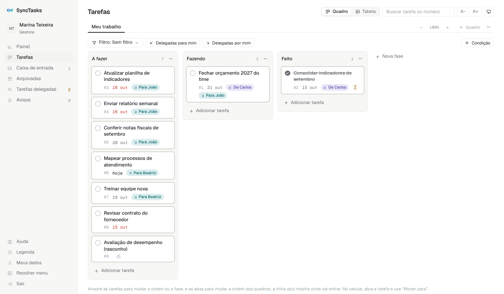

- **Novo quadro:** clique em **+ Quadro**, à direita das abas. Ele já vem com as fases A fazer, Fazendo e Feito.
- **Nova tarefa:** clique em **+ Adicionar tarefa** no fim de uma fase, digite o título e tecle Enter. Colou uma lista? O app pergunta se cria uma tarefa por linha ou uma só.
- **Mover:** arraste a tarefa para outra fase, ou para cima e para baixo. Uma linha azul mostra onde ela vai cair. Para outro quadro, abra a tarefa e use **Mover para**.
- **Abrir:** clique no título para editar descrição, prazo, checklist e comentários.
- **Concluir:** clique no círculo à esquerda do título. Errou? Abra a tarefa e clique em **Desfazer conclusão**.
- **Arquivar:** na tarefa concluída aparece um ícone de arquivo no canto do cartão. O aviso embaixo traz **Desfazer** por alguns segundos.
- **Número:** toda tarefa tem um número no quadro, como **#12**. Digite o número na busca para abrir a tarefa.
- **Cor do cartão:** na tarefa aberta, clique em **Cor**, ao lado do número. A cor é só sua.
- **Privada:** marque dentro da tarefa para que nem o seu superior conte essa tarefa. Tarefa delegada não pode ser privada.
- **Menu do quadro (…):** renomear, cor do quadro, nova fase, mover o quadro, fundo da tela, importar ou exportar do Trello e arquivar o quadro (só vazio).
- **Zoom:** os botões **−** e **+** à direita das abas mostram mais ou menos fases de uma vez.

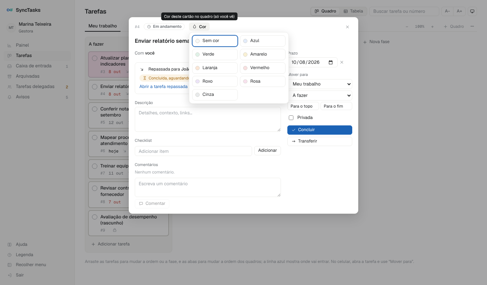

## Caixa de entrada

Tudo o que alguém delegou ou transferiu para você, e o que você capturou da web, chega primeiro na **Caixa de entrada**. Cada linha tem os botões para decidir o que fazer.

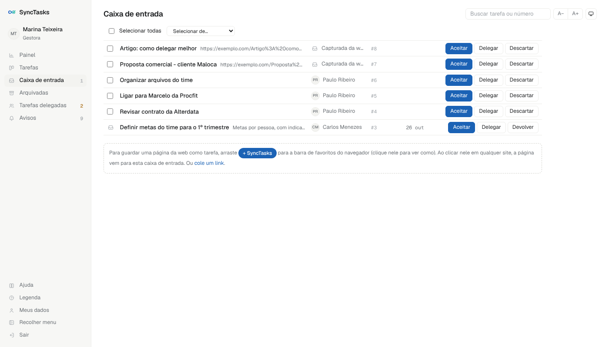

| Botão | O que faz | Quem é avisado |
| --- | --- | --- |
| **Aceitar** | Você escolhe o quadro e a fase, e a tarefa vai para lá. | Quem delegou recebe aviso de que você aceitou. |
| **Delegar** | Numa janela só, escolhe onde fica a sua tarefa e o subordinado direto que vai fazer. Só para quem tem equipe. | Quem delegou e quem recebe. |
| **Devolver** | Recusa uma tarefa delegada, com justificativa obrigatória. Ela volta para quem delegou. | Quem delegou. |
| **Descartar** | Tira da caixa sem concluir. Vai para Arquivadas, marcada “Descartada”. | Ninguém. |

Tarefas que chegaram por delegação mostram **Devolver** no lugar de Descartar, porque quem delegou espera por elas. O prazo vem sugerido por quem delegou; se você mudar, essa pessoa é avisada.

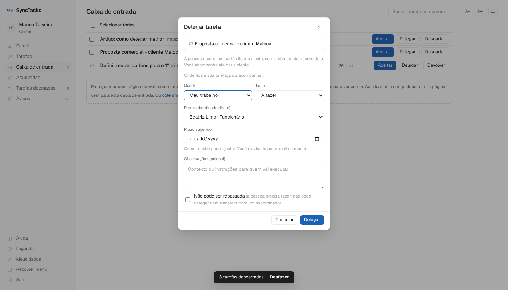

### Descartar várias de uma vez

1. Marque as caixinhas à esquerda das tarefas. Para pegar tudo, use **Selecionar todas**. Para pegar tudo o que veio de uma pessoa, use **Selecionar de…** e escolha o nome.
2. Clique em **Descartar selecionadas** e confirme.
3. O aviso embaixo traz **Desfazer**. Depois disso, cada tarefa ainda pode voltar pela tela **Arquivadas**, com **Desarquivar**.

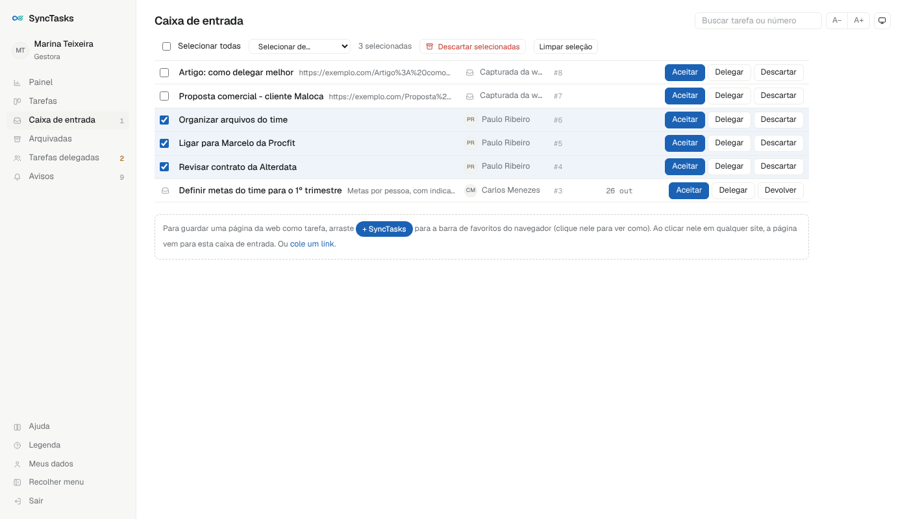

## Delegar e acompanhar

Quem tem equipe delega de dentro de uma tarefa, sempre para **um subordinado direto**. Você continua acompanhando até dar o **ciente**.

### Delegar

1. Abra a tarefa e clique em **Delegar**.
2. Escolha a pessoa, o prazo sugerido e, se quiser, uma observação.
3. Se a própria pessoa precisa fazer, marque **Não pode ser repassada**: ela não consegue delegar a tarefa adiante.
4. A pessoa recebe a tarefa na caixa de entrada dela, com aviso no app e por e-mail.

No seu quadro, a tarefa ganha a etiqueta verde-azulada **Para [nome]**. No quadro de quem recebe, aparece a etiqueta roxa **De [seu nome]**.

### O caminho de uma tarefa delegada

1. **Aguardando aceite:** a tarefa está na caixa de entrada da pessoa. Ela aceita ou devolve com justificativa.
2. **Em andamento:** a pessoa trabalha nela no quadro dela.
3. **Aguardando ciente:** a pessoa concluiu. Você recebe o aviso.
4. Você escolhe:
    - **Dar ciente:** aceita a entrega. A tarefa é arquivada e a pessoa é avisada.
    - **Reabrir:** não aceita a entrega. Escreva o motivo; a tarefa volta para a pessoa.

Se a pessoa **devolver**, você pode **Redelegar** (para ela ou outra pessoa, com o mesmo cartão) ou **Cancelar**.

### Cancelar uma delegação

Mudou de ideia? Abra a sua tarefa e, no bloco **Repassada para**, clique em **Cancelar delegação**. A tarefa sai do quadro da pessoa e continua com você. O aviso na tela traz **Desfazer**, que vale por até 10 minutos.

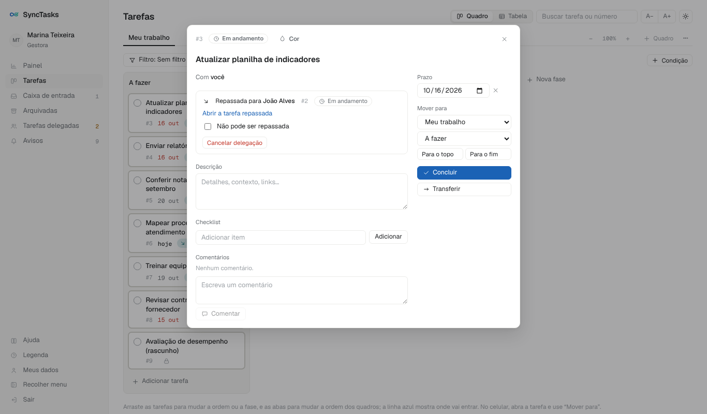

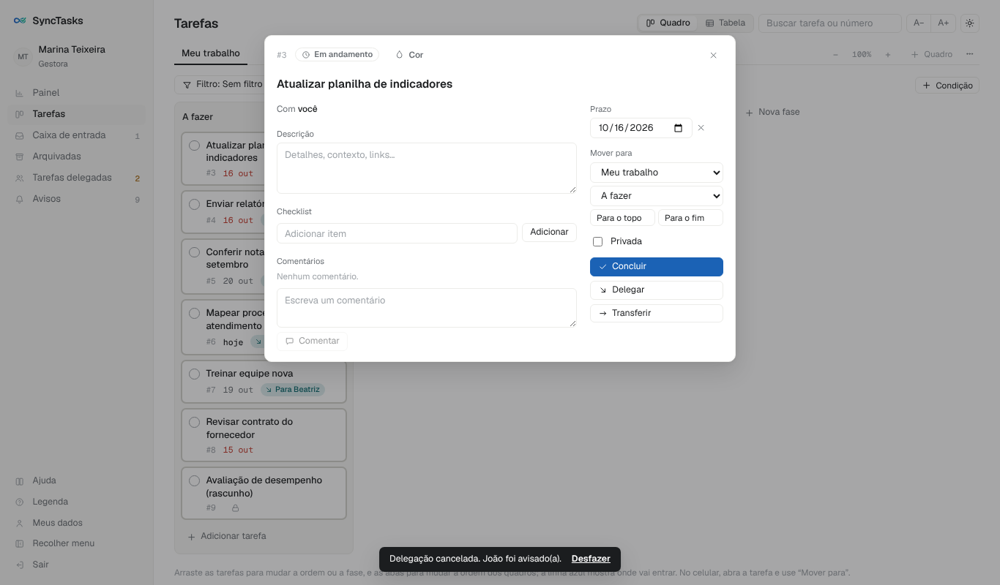

### Onde acompanhar

- **Painel:** resumo do que você delegou, uma barra por pessoa (azul no prazo, vermelho atrasadas), o que vence nos próximos 14 dias e o que está parado.
- **Tarefas delegadas:** no topo, o que **precisa da sua ação** (aguardando ciente e devolvidas); abaixo, um grupo por pessoa da equipe.
- **No quadro:** o atalho **Delegadas por mim** mostra só o que você delegou e ainda espera o seu ciente.

### Transferir não é delegar

**Transferir** passa a tarefa para outra pessoa (um subordinado, um colega do mesmo nível ou o seu superior direto) e você **deixa de acompanhar**. Ao **delegar**, você continua acompanhando até o ciente.

## Filtros no Quadro e na Tabela

Em **Tarefas**, a chave **Quadro / Tabela** (no topo, à direita) troca entre os quadros e uma tabela com as tarefas de todos os seus quadros. O mesmo filtro vale nas duas visões e continua ligado quando você troca.

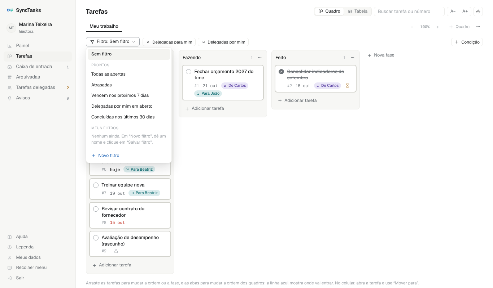

- **Filtros prontos:** clique em **Filtro** e escolha, por exemplo, **Atrasadas**, **Vencem nos próximos 7 dias** ou **Delegadas por mim em aberto**.
- **Atalhos:** ao lado do Filtro, **Delegadas para mim** e **Delegadas por mim**. Um clique liga, outro desliga.
- **No quadro:** as tarefas que não atendem ao filtro somem, e cada fase mostra a contagem, como “3 de 10”. A faixa azul tem o botão **Limpar filtro**.
- **Montar o seu filtro:** clique em **+ Condição** e escolha campo, operador e valor, por exemplo “Prazo · nos próximos · 7 dias”. Dê um nome e clique em **Salvar filtro**. Só você vê os seus filtros.
- **Na tabela:** clique no título de uma coluna para ordenar. O botão **Colunas** mostra outras colunas, e **Exportar planilha** baixa um arquivo que abre no Excel.

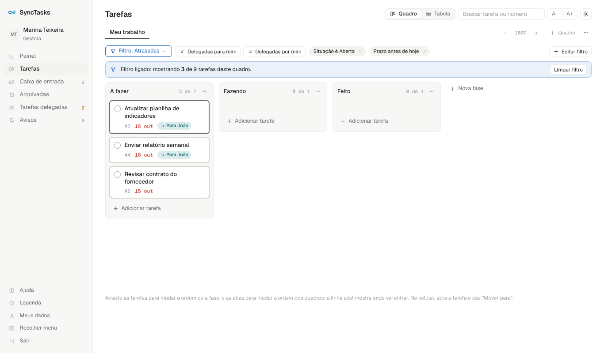

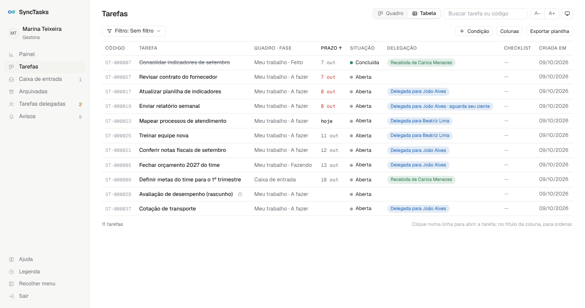

## Arquivadas

No menu à esquerda, **Arquivadas** lista o que você arquivou ou descartou, da mais recente para a mais antiga. Nada se perde.

- **Pesquisar:** digite o número (12 ou #12) ou palavras do título.
- **Desarquivar:** o botão na linha devolve a tarefa à mesma fase. Uma tarefa **descartada** volta para a caixa de entrada.
- **Quadros arquivados** aparecem no topo, também com **Desarquivar**.
- As tarefas que você delegou e em que deu o ciente aparecem só para consulta.

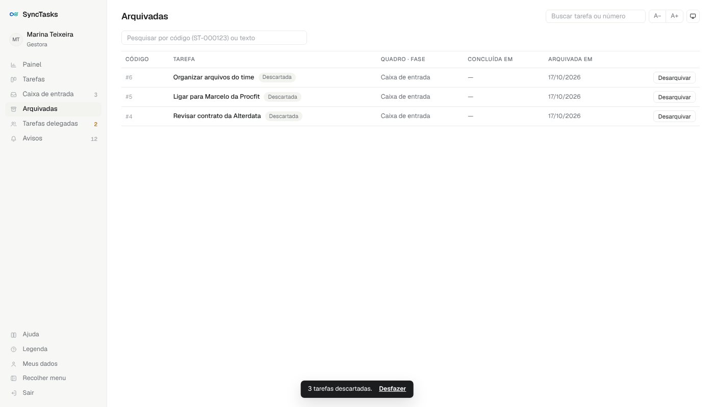

## E-mails e avisos

Os avisos chegam no sino **Avisos**, no menu, e por e-mail.

| Aviso | Quando chega | Para quem |
| --- | --- | --- |
| Delegação | Tarefa delegada, aceita, devolvida, concluída, reaberta, com ciente, cancelada ou transferida | Os envolvidos |
| Prazo amanhã | Na véspera do prazo | Quem está com a tarefa |
| Prazo vencido | No dia seguinte ao prazo, se continuar aberta | Quem está com a tarefa e quem delegou |
| Resumo do dia | Às 7h, de segunda a sexta, só quando há algo | Você: o que vence hoje, atrasadas, a aceitar e a dar ciente |

Cada e-mail tem o número da tarefa e um link que abre direto nela.

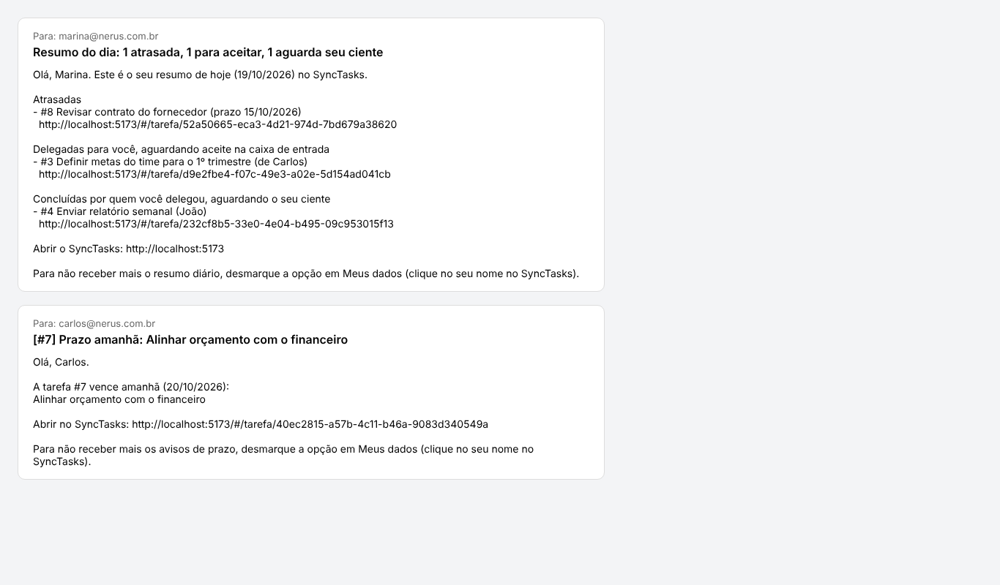

## Meus dados e aparência

Clique no seu nome, no alto do menu (ou em **Meus dados**, embaixo), para desligar o **resumo diário** ou os **avisos de prazo**. Os avisos de delegação chegam sempre.

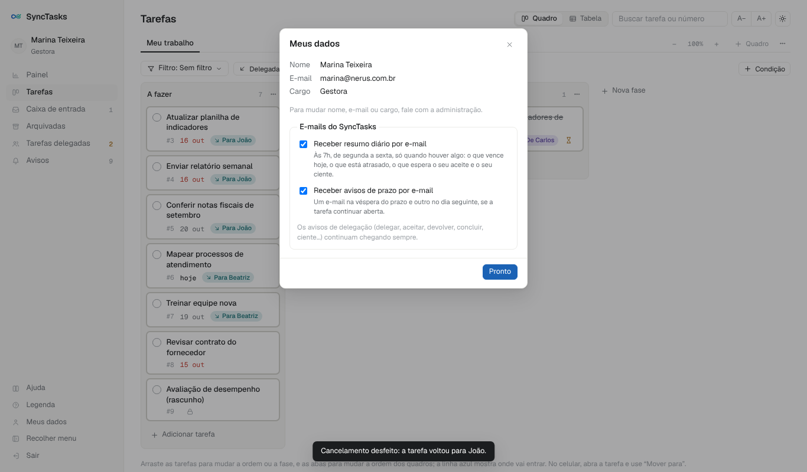

- **Tema:** o botão no topo, à direita, alterna entre automático, claro e escuro.
- **Tamanho do texto:** **A−** e **A+**, no topo.
- **Fundo da tela:** no menu **…** do quadro, escolha a cor de fundo. Fica guardado na sua conta.
- **Menu recolhido:** **Recolher menu**, no rodapé do menu, deixa só os ícones.

## Perguntas frequentes

**Meu superior vê o meu quadro?** Não. Ele vê só as tarefas que delegou a você e quantas tarefas próprias você tem (sem as privadas).

**Não aparece o botão Delegar.** Ele só aparece para quem tem subordinados diretos, em tarefas abertas e ainda não delegadas.

**Posso mudar o prazo de uma tarefa que recebi?** Pode. Quem delegou recebe um aviso com o prazo antigo e o novo.

**Concluí por engano.** Abra a tarefa e clique em **Desfazer conclusão**. Depois do ciente, não dá mais.

**Descartei sem querer.** Vá em **Arquivadas** e clique em **Desarquivar**: a tarefa volta para a caixa de entrada.
